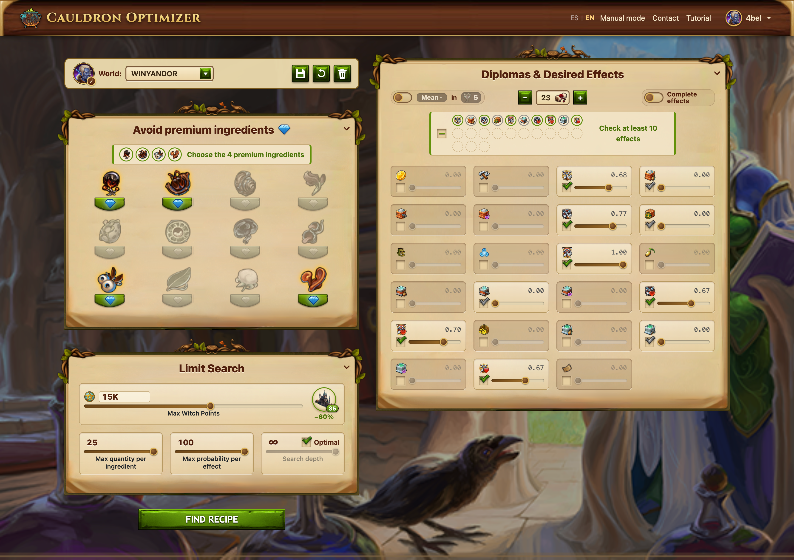

# Cauldron Optimizer

<p align="center">
  
</p>
<p align="center">
  <em>
    Web interface for selecting target effects and constraints before running the recipe optimization.
    After configuration, the optimizer computes and displays the recommended ingredient recipe
    and the corresponding effect probabilities.
  </em>
</p>

**Probabilistic Recipe Optimization for Elvenar**

This repository contains a production web application that helps players choose
ingredient combinations for the Elvenar Cauldron to maximize the expected value
of desired effects.

The application is **deployed and actively used by players**.  
**Live application:** https://cauldron-optimizer.vercel.app

The underlying cauldron mechanics produce probabilistic outcomes: for a fixed
recipe, the realized effect is random. The optimization *objective and scoring
model* are deterministic, while the search procedure may use randomized
initialization to explore the solution space. The final recommendation is chosen
by maximizing a weighted expected-effect objective.

**Deployed:** Vercel (Flask backend) + Neon (PostgreSQL)

Originally deployed on Render, migrated to Vercel to eliminate cold-start latency and improve responsiveness.

**Used by:** active players (accounts stored in the database)  

## What the app does

Given:
- a set of desired effects and their user-defined weights,
- constraints (e.g., ingredient limits, premium ingredients excluded),
- a fixed total ingredient budget,

The optimizer returns a recipe vector $\alpha$ (integer ingredient counts) that maximizes the chosen objective:
- **Weighted score** (default): the weighted expected outcome of the desired effects.
- **"All in" over goblets**: with $n$ goblets (brews, 1–5), the effects are only wanted or not
  (weights 0/1) and the objective is either
  - **"Most"** ("Máximo", the default): the most *different* wanted effects on average, i.e. their expected number in the $n$ goblets (shown in the results as "Expected effects"), or
  - **"≥ $k$" / "All"** ("Todos"): the probability of getting at least $k$ different wanted effects
    (all of them, up to $\min(n, \text{wanted})$, with "Todos").

Other features:
- **Witch Point limit** and the level of the *Escuela de hechicería valoriana* (which lowers the prices).
- **"Complete effects" mode**: given fewer than 10 weighted effects, a long background search tries
  every set of complementary effects (with all 495 combinations of 4 avoided ingredients) and ranks
  them; progress is saved per world, so it can be resumed later or from another device.
- **Worlds**: each account keeps several worlds (servers), each with its own saved settings and avatar.
- **Foldable panels**: each settings card folds by its title, so panels already set can be put
  away and not changed by accident while scrolling (remembered per browser).
- Spanish and English interface.


## Core model (probability scoring)

Let $d$ be the number of effects considered, and let $\alpha$ be the 12-dimensional vector of ingredient counts. The scoring model used by the optimizer is:

```math
\begin{aligned}
E_i(\alpha)
&= \max\!\left(
\sum_{j=1}^{12} \alpha_j v_{i,j},\, 0
\right)
\cdot 1.1^{\sum_{j=1}^{12} \alpha_j b_{i,j}} \\[6pt]
\hat{E}_i(\alpha)
&= 20\,\frac{E_i(\alpha)}{\sum_{k=1}^{d} E_k(\alpha)}
\sqrt{\sum_{j=1}^{12} \alpha_j} \\[6pt]
F(\alpha)
&= \sum_{i=1}^{d} w_i\,\hat{E}_i(\alpha)
\end{aligned}
```

where:
* $V = (v_{i,j})$ and $B = (b_{i,j})$ are constant matrices (stored in CSV and loaded at runtime),
* $w = (w_i)$ are user-selected weights over effects,
* $\alpha$ is a non-negative integer recipe vector with a hard budget constraint: $\sum_{i=1}^{12}\alpha_i \leq 25$.

The optimizer uses $F(\alpha)$ as the objective and enforces probability caps and ingredient constraints.

### Goblet objectives

With $n$ goblets, let $q_i = \hat{E}_i(\alpha)/100$ be the chance of wanted effect $i$ in one brew
(the per-effect cap does not apply here). Then:

```math
\text{Most}(\alpha) = \sum_{i \in \text{wanted}} \left(1 - (1 - q_i)^{n}\right)
```

and the probability of getting at least $k$ different wanted effects is computed exactly as
$n!\,[x^n]$ of the terms with at least $k$ factors $(e^{q_i x} - 1)$ in
$e^{r x}\prod_i\left(1 + (e^{q_i x} - 1)\right)$, with $r = 1 - \sum_i q_i$
(see `rounds_probability` and `expected_effects` in `optimizer.py`). The mean has a closed
form and is about as cheap as the weighted score; "at least $k$" is the costlier objective.


## Optimization method

The optimization problem is discrete, constrained, and non-linear (due to the max, exponent,
normalization, and square-root terms). Two searches are available:

* **Normal search: iterated local search.** Steepest-ascent hill climbing over integer recipes
  (moves: add one unit, or move one unit between ingredients) with efficient incremental updates
  from precomputed matrix columns and objective caching. Half of the budget climbs from independent
  random starts; the other half "kicks" the best recipe (6 random units moved) and climbs again,
  keeping improvements. The budget is the *search depth* setting on the page.
* **"Óptima": exact search.** Enumerates every recipe within the bounds (about 12–14 million with
  4 ingredients avoided, 1–2 s in the browser) and guarantees the optimum. For "at least $k$",
  a cheap binomial upper bound skips the full formula for recipes that cannot beat the best one.

Both run in the browser (`static/js/solver.js`, in Web Workers), with the Python implementation
(`CauldronOptimizer.greedy()` and `CauldronOptimizer.multistart()`) as the server-side fallback.


## Tech stack
* Python + NumPy (reference optimization engine, server fallback)
* JavaScript + Web Workers (in-browser search and "Complete effects" search)
* Flask (web backend), Flask-Babel (Spanish/English)
* PostgreSQL (Neon)
* Hosted deployment (Vercel)


## Local setup

1. Clone the repository
2. Install dependencies:
   ```bash
   pip install -r requirements.txt
   ```
3. Copy `.env.example` to `.env` and fill in your credentials:
   ```bash
   cp .env.example .env
   ```
4. Set up your PostgreSQL database and update `NEONDB_USER` in `.env`
5. Run the Flask app:
   ```bash
   flask run
   ```

## Browser extension integration

The page exposes a same-origin `postMessage` API so browser extensions do not
need to depend on internal routes or CSRF implementation details.

Select an existing world, or create it with the default avatar when missing:

```js
window.postMessage({
  type: "cauldron:selectWorld",
  name: "EA-Balrogville-en3",
  create: true,
}, location.origin);
```

The page responds with `cauldron:selectWorld:result` containing `ok`,
`created`, `reloading`, `errors`, and the selected `world`. A changed
selection reloads the page; the extension can resume after the next
`cauldron:ready`.

Autofill can optionally save through the same operation as the Save button:

```js
window.postMessage({
  type: "cauldron:autofill",
  n_diploma: 7,
  premium_ingr: [0, 1, 10, 11],
  selected_effects: [0, 1, 2, 3, 4, 5, 6],
  wonder_level: 12,
  wp_max: 15000,
  goblets: 5,
  all_in: true,
  at_least: 4,
  save: true,
}, location.origin);
```

The values are only examples; send the player's own. All fields are optional:

| field | value |
|---|---|
| `n_diploma` | integer, 1 to the number of effects |
| `premium_ingr` | ingredient indexes 0–11 (game order), at most 4 |
| `selected_effects` | effect indexes 0 to `n_diploma` − 1 to check; the others are unchecked and their weight goes to 0. A search needs at least 10 checked (or all of them, with fewer than 10 diplomas) and one with a weight |
| `wonder_level` | level of the Escuela de hechicería valoriana, 0 (not built) to 35; sets the Witch Point prices |
| `wp_max` | Witch Points the recipe may cost: a positive integer, or `null` for no limit. The useful range runs from the price of one ingredient (50 with the school not built, 32 at level 12) to the most expensive recipe, 25 units of one ingredient (about 4.5M not built, 2.9M at level 12) |
| `goblets` | goblets (brews) for "All in", 1 to 5 |
| `all_in` | `true`/`false`: the "All in" switch. On, the search looks for the best chance of getting all the wanted effects (weight > 0) within `goblets` brews, or as many as there are goblets when more effects are wanted; the weights become 0 or 1 and the per-effect probability cap does not apply |
| `at_least` | with "All in": at least this many of the wanted effects instead of all of them, 0 (all) to 5. At or above min(`goblets`, wanted effects) it means all, so `applied.at_least` comes back as `0`. `"mean"` (or `-1`, the default for new worlds) maximizes the expected number of different wanted effects instead. Applied after `all_in` |
| `save` | `true` to save after applying |

`selected_effects` is applied after `n_diploma`, so the indexes refer to the
new number of diplomas. `wonder_level` is applied before `wp_max`, so the limit
is checked against the new prices. A `wp_max` at or above the cost of the most expensive recipe means
no limit, so `applied.wp_max` comes back as `null`. The page announces
`cauldron:ready` with `version: 3` when it supports `wonder_level` and
`wp_max`, `version: 4` for `selected_effects`, `version: 5` for `goblets`
and `all_in`, `version: 6` for `at_least`, and `version: 7` for
`at_least: "mean"`. Setting `goblets` alone leaves the switch as it is (in the page,
picking goblets also turns it on).

Premium ingredient exclusions remain temporary and are never persisted, which
matches the Save button's behavior. The selected effects, wonder level, Witch Point limit,
goblets and "All in" switch are saved per world; a world that never saved a level (new worlds included)
starts with the school not built.

Failed results include a stable `code` next to the readable `errors`:

| code | meaning |
|---|---|
| `complement_mode` | "Complete effects" mode is on; nothing was changed (the player must turn it off) |
| `not_found` | no world with that name, and `create` was not `true` |
| `too_many_worlds` | the account already has the maximum number of worlds |
| `invalid_name` | empty name, or longer than the 24-character limit |
| `invalid_data` | wrong fields (details in `errors`) |
| `save_failed`, `network`, `db_error` | the request did not go through |

## Notebook (explanation and examples)

Jupyter notebooks at the repository root document the model:
- `solver.ipynb`: step-by-step explanation of the scoring model and example local usage of the optimizer.
- `formula.ipynb`: the scoring formula, with tests.
- `all_effects.ipynb`: derivation of the goblet objectives: the probability of getting all
  (or at least $k$) desired effects, by inclusion–exclusion, and the expected number of different
  desired effects.

The notebooks are intended for documentation and experimentation; the production
system runs as a deployed web application.
